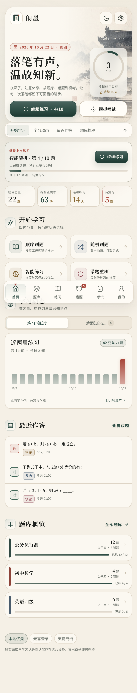
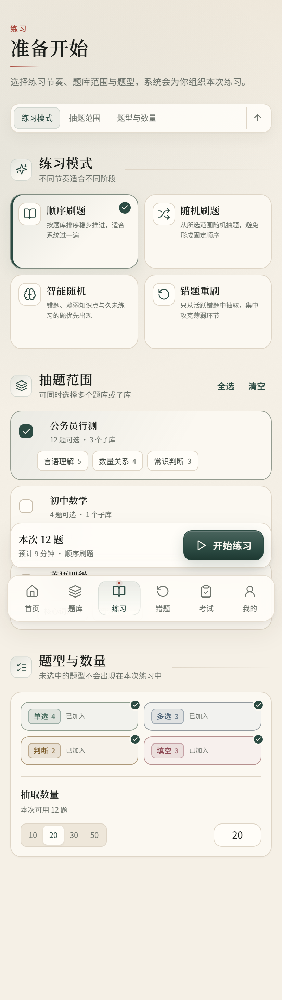
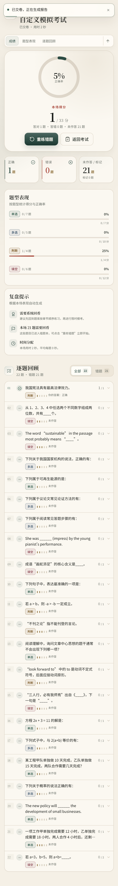
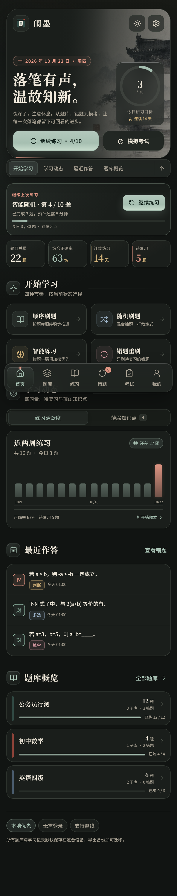

# 闱墨

“闱墨”是一款移动端优先、本地优先的题库与沉浸式刷题应用。它支持题库导入导出、顺序与智能练习、错题回流、笔记和模拟考试，并以“宣纸、玄墨、黛青、朱砂”为核心视觉语言。

> 一卷一答，墨见真知。

当前版本：**2.0.0**（localStorage schema v2，兼容 v1 数据）。

[使用说明](./使用说明.md) · [题库制作指南](./题库制作指南.md) · [AI Skill](./.agents/skills/question-bank-builder/SKILL.md) · [GitHub 仓库](https://github.com/chuankkk/weimo) · [Releases](https://github.com/chuankkk/weimo/releases) · [MIT License](./LICENSE)



## 为什么是闱墨

大多数刷题工具把题库、错题和学习记录锁在账号或云端；闱墨选择相反的路线：**题库属于你，数据留在本机**。

- 不需要注册，不依赖网络，不收集学习数据。
- 题库、作答、错题、笔记、模拟考试都在一个应用里，导入即可用。
- 数据格式开放：CSV / Excel / JSON 导入导出，完整备份可迁移。
- 视觉不是通用后台模板，而是“宣纸、玄墨、黛青、朱砂”的东方书卷气质。
- 同一套代码同时提供 Web / PWA 与 Android 客户端。

## 核心能力

| 能力 | 说明 |
| --- | --- |
| 题库工作台 | 一级题库/子库、搜索筛选、分页、题目编辑、题库合并、Excel/CSV/JSON 导入导出 |
| 四种练习 | 顺序、随机、智能加权、错题重刷；断点续做、答题解析、同题笔记 |
| 错题回流 | 待复习/已掌握/已忽略、按题库与关键词筛选、单题/批量重刷、增量加载 |
| 模拟考试 | 多题库蓝本组卷、限时作答、答题卡、自动交卷、题型报告、逐题复盘 |
| 数据自主 | localStorage 本地优先、完整备份恢复、存储占用提示、无账号无遥测 |
| 长页面导航 | 首页、练习、考试、我的、报告均有粘性页内跳转与回到顶部 |
| AI 题库制作 | 配套 `question-bank-builder` skill、格式校验器、质量量表与提示词模板 |

## 界面预览

<table>
  <tr>
    <td align="center"><br /><sub>首页 · 今日目标与快速开始</sub></td>
    <td align="center"><br /><sub>练习 · 模式、范围与题型</sub></td>
  </tr>
  <tr>
    <td align="center"><br /><sub>考试 · 得分与逐题复盘</sub></td>
    <td align="center"><br /><sub>夜墨 · 暗色阅读体验</sub></td>
  </tr>
</table>

## 适合谁

- 备考公务员、事业单位、考研、法考、教师资格、医考等考试，想自己掌控题库的人。
- 教师、培训师、学习小组，需要把讲义/题库变成可练习应用的人。
- 喜欢本地优先、无账号、可导出数据的工具控。
- 想用 AI 批量生产题库，又需要严格格式与质量校验的人。

## 技术栈

| 层 | 选型 |
| --- | --- |
| UI | React 18 + TypeScript 5 |
| 构建 | Vite 8、hash 路由、按页面拆分 CSS |
| 状态 | React Context + `AppProvider`，派生索引用 `useMemo` |
| 存储 | localStorage schema v2，旧数据自动归一化 |
| 导入导出 | `read-excel-file` / `write-excel-file`，CSV/JSON 原生解析 |
| 客户端 | Capacitor 8（Android），PWA + Service Worker |
| 视觉 | 宣纸/玄墨/黛青/朱砂 token，自托管 Noto Sans/Serif SC |

## 2.0 版做了什么

### 架构重构

- `src/App.tsx` 从 1,871 行的单文件拆分为路由外壳 + 六个页面模块；业务逻辑下沉到 `lib/`、`data/`、`store/`。
- 新增 `AppProvider` 统一管理状态、派生索引、主题、Toast、确认弹窗和防抖持久化。
- 新增 `lib/catalog.ts` 题库/题目索引，题库或题目变化时才重建；答题只更新记录和错题，不再每次全量扫描题目。
- 新增 hash 路由（`#/practice?run=1`、`#/exam?session=...`），支持刷新恢复、浏览器前进后退和深链接。
- 新增 `schemaVersion: 2` 与 `normalizeState`：旧本地数据、旧备份 JSON 都会补齐字段、剔除孤儿记录、修复循环父级引用。
- 新增 `AppErrorBoundary`，页面异常时给出可恢复提示，而不是白屏。

### 性能优化

- 首页、错题、题库详情、考试报告使用索引与 `useMemo` 缓存，避免重复扫描几千道题。
- 加权随机从 O(n²) 改为 Efraimidis–Spirakis 指数键 O(n log n)；顺序模式只排序一次。
- 知识点错误率、统计、题型正确率改为单次遍历，避免 `记录 × 题目` 嵌套扫描。
- 搜索使用 `useDeferredValue`，大题库输入不卡顿。
- localStorage 保存改为 240ms 防抖，并在 `pagehide`/页面隐藏时立即落盘。
- Excel/CSV 解析与导出库改为动态 import，只在导入/导出时加载对应 chunk。
- 首页主视觉从 2.4 MB PNG 压缩为 243 KB JPEG，并提供 115 KB 的 1200px 响应式版本；删除两张大体积未使用图片。
- 大题量列表分页（题库详情每页 20 题）、按需筛选，避免一次渲染全部题目。

### 体验与功能补全

- 练习支持**断点续做**：退出/刷新后仍能从上次题号继续；完成后进入练习总结（正确率、用时、逐题回顾、错题重做）。
- “答对后自动下一题”设置真正生效；练习页支持数字键选项、Enter 提交/继续。
- 填空题按空逐个输入，支持等价答案与全角/半角归一化。
- 模拟考试加入**真实倒计时、超时自动交卷、答题卡、标记回看、断点续考**；交卷后生成得分、题型表现和逐题解析报告，历史成绩可回看。
- 题库管理补全：新建/编辑/删除题库与子库、手工新增/编辑/删除题目、题目搜索/题型筛选/分页、合并题库并阻止“合并进自己的子库”。
- 数据工具补全：CSV/Excel/JSON 导入导出、导入模板下载、完整备份**恢复**（带覆盖确认）、重复题去重、错误/警告报告。
- 错题本支持待复习/已掌握/已忽略三种状态、按题库与关键词筛选、查看答案解析、单题重刷、批量重刷、恢复待复习；列表每批 20 条增量加载。
- 首页新增今日目标环、近 14 天练习活跃度、最近作答、题库进度和薄弱知识点；手机上“练习活跃度 / 薄弱知识点”改为切换卡，首页整体高度比上一版减少约 20%。
- 长页面加入粘性页内导航与回到顶部（首页、练习配置、模拟考试、我的、考试报告），不用反复上下滑动找入口。
- 外观升级为日宣/夜墨/跟随系统，切换即时生效并持久化；`prefers-color-scheme` 在 React 挂载前即恢复，避免闪白。
- 桌面端新增左侧导航栏；移动端保留底部导航、安全区适配和 320px 起的窄屏布局。
- 无障碍补全：跳转主内容、焦点可见、aria-label、aria-current、aria-pressed、模态框焦点陷阱与 Esc 关闭、Toast `aria-live`、`prefers-reduced-motion`。

## 视觉系统

- 字体：随包离线部署 Noto Sans SC Variable 与 Noto Serif SC Variable。
- 色彩：宣纸 `#F5F0E6`、素笺 `#FBF8F1`、玄墨 `#1C1F1C`、黛青 `#2C4B43`、朱砂 `#A8463A`、金泥 `#86662F`。
- 版式：宋体用于品牌、页面标题、题干和指标数字；正文与控件使用黑体。4px 间距基线，控件 10px / 卡片 14px / 大面板 22px 圆角。
- 纸面：低对比纸质噪点、细界格线、极轻阴影；只有底栏、浮层和固定操作条使用明显阴影。
- 图形：Lucide 单色墨线统一 1.7 线宽；品牌图形为“门形 + 卷页 + 朱砂点”。
- 运行态：练习/考试进入沉浸布局，隐藏全局导航；固定提交区避开安全区。

详细设计说明见 [闱墨UI设计系统.md](./闱墨UI设计系统.md)。

## 目录结构

```text
src/
  App.tsx                 # 路由外壳、错误边界
  main.tsx                # 字体、样式、PWA 注册
  types.ts                # 领域模型
  lib/
    catalog.ts            # 题库/题目索引与题目池缓存
    quiz.ts               # 判题、抽题、加权抽样、错题掌握度
    stats.ts              # 统计、知识点弱项、错题行
    exam.ts               # 组卷、倒计时、交卷、成绩
    banks.ts              # 题库路径与小工具
    date.ts / text.ts     # 日期、归一化、格式化
    router.ts / hooks.ts  # hash 路由、计时/快捷键 hooks
  data/
    seed.ts               # 演示题库
    storage.ts            # schema v2 读取/规整/保存
    io.ts                 # 导入导出、完整备份恢复
  store/
    AppStore.tsx          # Provider、主题、Toast、Confirm、持久化
    actions.ts            # 题库/题目/错题/练习原子更新
  components/
    ui.tsx                # Button/Chip/Progress/Modal 等基础件
    overlays.tsx          # Modal、Toast、ConfirmHost
    question.tsx          # 题干、选项、填空、解析、笔记
    QuestionEditor.tsx    # 新增/编辑题目
    DataTools.tsx         # 导入导出工具组
    BottomNav.tsx         # 移动底栏 / 桌面侧栏
  pages/                  # 首页、题库、练习、错题、考试、我的
  styles/                 # tokens / base / components / 各页面样式 / responsive
```

## 数据与兼容

- 本地存储键仍是 `shuati-wang-state-v1`，字段保持向后兼容；新增 `schemaVersion`、`practiceSession`、`ExamSession.currentIndex` 等可选字段。
- 读取时统一经过 `normalizeState`：补齐设置、校验题型与答案、剔除指向已删除题目的记录、限制掌握度范围、修复循环父级。
- “我的 → 数据 → 完整备份”导出 JSON；“导入题库文件”选择该 JSON 时会提示覆盖当前全部数据，可用于换机迁移。
- 所有数据默认只保存在本机；导出备份后即可迁移或归档。

## 本地运行

```bash
npm install
npm run dev
```

默认地址：`http://localhost:5173/`。

## 构建

```bash
npm run build        # 标准版（内置演示题库）
npm run build:empty  # 空白版（不含演示题库）
```

生产产物输出到 `dist/`。`npm run preview` 可在本地预览生产构建。

## Android 构建

同步 Web 资源并构建：

```bash
npm run android:debug          # 标准版 Debug APK
npm run android:release        # 标准版 Release APK
npm run android:debug:empty    # 空白版 Debug APK
npm run android:release:empty  # 空白版 Release APK
```

输出目录：

```text
android/app/build/outputs/apk/debug/app-debug.apk
android/app/build/outputs/apk/release/app-release.apk
```

### 签名

Release 构建需要在本地创建 `android/keystore.properties` 并准备 keystore。该文件、`android/signing/` 与所有 `*.p12` / `*.jks` / `*.keystore` 都已被 `.gitignore` 忽略，不会进入公开仓库。本仓库不包含任何签名密钥、密码或私人证书信息；请使用你自己的 keystore，并妥善备份。

应用显示名为“闱墨”，包名仍保留 `com.shuatiwang.app`，以维持已有安装和本地数据兼容。

### 标准版与空白版

- **标准版**：首次启动内置 3 个一级题库、9 个题库、22 道演示题，适合体验完整流程。
- **空白版**：通过 `VITE_EMPTY_STATE=true` 构建，首次启动题库为空，只显示“从零开始”的导入/建库引导。

```bash
npm run build:empty
# 或
npm run android:release:empty
```

APK 本身不包含用户数据。首次安装或清除应用数据后：标准版会生成演示题库，空白版保持 0 题。**覆盖安装会保留原有本地数据**；在应用内可用“我的 → 维护 → 清空学习记录 / 恢复演示数据”重置。

公开仓库不提交 APK 文件（`artifacts/` 与 `*.apk` 已忽略）。GitHub Releases 提供 debug 签名试用包；正式发布包请按上面的命令自行构建并使用自己的 keystore 签名。

## 题库制作与 AI

题库制作有一套独立的 [题库制作指南](./题库制作指南.md)，以及可被 AI Agent 直接加载的 [question-bank-builder skill](./.agents/skills/question-bank-builder/SKILL.md)：

```text
.agents/skills/question-bank-builder/
├── SKILL.md                 # AI 工作流、格式硬约束、交付要求
├── references/
│   ├── import-format.md     # 字段/答案/CSV/JSON 完整规范
│   ├── quality-rubric.md    # 100 分质量量表
│   ├── prompts.md           # 可直接复制的提示词模板
│   └── question-bank.schema.json
├── scripts/validate-bank.mjs
└── examples/sample-bank.csv|json
```

最短用法：

```text
使用 question-bank-builder skill，为「初中生物·光合作用」制作 20 道题。
单选 10、多选 4、判断 4、填空 2；难度混合；输出 CSV，并用 --strict 校验通过。
```

校验器不依赖第三方库：

```bash
node .agents/skills/question-bank-builder/scripts/validate-bank.mjs 你的题库.csv --strict
```

它会检查单选题是否只有一个答案、多选答案键是否存在、填空空数与答案组数是否一致、是否有重复题、CSV 是否在单元格内换行、JSON 是否为完整备份等。完整字段、常见错误和 AI 工作流见 [题库制作指南](./题库制作指南.md)。

### 导入格式速览

可参考 `题库导入模板.csv`，也可以在“题库 → 导入导出”中直接下载模板。

核心字段：大题库、小题库、题型、题干、选项A–H、答案、可接受答案、解析、知识点、标签、难度、来源、排序号。

答案示例：

```text
单选：B
多选：A,C,D
判断：对 / 错 / true / false
填空：第一空答案;第二空答案
填空等价答案：北京|北京市;鲁迅|周树人
```

CSV 一题一行，单元格内不能换行；含逗号的字段必须用双引号包裹。普通题库文件是合并导入，完整备份 JSON 才会覆盖数据。

## 验证

主要验证命令：

```bash
npm run build
```

视觉验收覆盖 320 / 412 / 1440px、日宣与夜墨、练习/考试沉浸态、桌面侧栏和空白版首次启动：

- `docs/screenshots/home-mobile.png`：首页移动端
- `docs/screenshots/home-full.png`：首页完整页面
- `docs/screenshots/home-desktop.png`：桌面首页与侧栏
- `docs/screenshots/home-empty.png`：空白版首次启动
- `docs/screenshots/night-theme.png`：夜墨首页
- `docs/screenshots/banks-mobile.png`：题库目录
- `docs/screenshots/bank-detail.png`：题库详情与题目索引
- `docs/screenshots/practice-setup.png`：练习配置
- `docs/screenshots/practice-runner.png`：答题与解析
- `docs/screenshots/practice-summary.png`：练习总结与回顾
- `docs/screenshots/wrong-mobile.png`：错题本
- `docs/screenshots/exam-planner.png`：模拟考试组卷
- `docs/screenshots/exam-runner.png`：考试答题与倒计时
- `docs/screenshots/exam-report.png`：考试报告
- `docs/screenshots/settings-mobile.png` / `settings-dark.png`：我的页面日间/夜间
- `docs/screenshots/android-runtime.png`：Android 模拟器 1080×2400 运行截图
- `docs/screenshots/android-empty.png`：空白版 Android 首次启动截图
- `docs/screenshots/home-baseline.png`：首页视觉基线

交互冒烟已验证：完整练习流程与总结、练习断点续做、错题单题重刷、考试倒计时自动交卷、答题卡交卷、考试报告、CSV 导入、完整备份恢复、Excel 导出、主题切换、320px 无横向溢出、空白版首次启动。

Android 集成：`npm run android:debug` / `android:release` 与对应的 `:empty` 空白版命令均已在 JDK 21 + Gradle 8.11.1 下构建通过。

## 文档索引

| 文档 | 适合谁 | 内容 |
| --- | --- | --- |
| [使用说明](./使用说明.md) | 使用者 | 安装、导入、练习、错题、考试、备份、常见问题 |
| [题库制作指南](./题库制作指南.md) | 出题人 / AI 使用者 | 蓝图设计、字段规范、四种题型、AI 工作流、验收清单 |
| [question-bank-builder skill](./.agents/skills/question-bank-builder/SKILL.md) | AI Agent | 可加载的题库制作 skill、格式硬约束、交付流程 |
| [题库格式完整说明](./.agents/skills/question-bank-builder/references/import-format.md) | 开发者 / 出题人 | 字段别名、答案解析、CSV/JSON 兼容性 |
| [出题质量量表](./.agents/skills/question-bank-builder/references/quality-rubric.md) | 审校者 | 100 分评分表、单题自检、人工抽检 |
| [AI 提示词模板](./.agents/skills/question-bank-builder/references/prompts.md) | AI 使用者 | 生成、转换、扩展、修复、组卷提示词 |
| [闱墨UI设计系统](./闱墨UI设计系统.md) | 设计 / 前端 | 色彩、字体、组件、响应式与验收 |
| [重设计验证方案](./刷题王重设计验证方案.md) | 测试 / 维护者 | 验证矩阵、交互冒烟、截图基线 |
| [完整设计方案](./刷题App完整设计方案.md) | 产品 / 贡献者 | 产品定位、信息架构、领域模型、路线 |

## 参与贡献

欢迎提交 Issue / Pull Request。提交前请确保：

- `npx tsc --noEmit --noUnusedLocals --noUnusedParameters` 通过；
- `npm run build` 通过；
- 不提交任何 keystore、密码、个人路径或用户数据；
- 新功能附带必要截图或说明。

## 开源协议

本项目使用 [MIT License](./LICENSE) 开源。题库、作答与笔记数据归使用者所有；仓库不收集任何个人数据。
